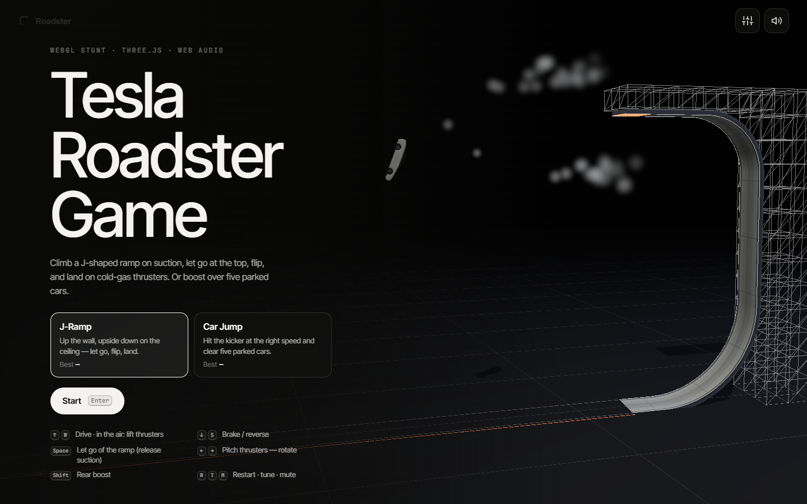
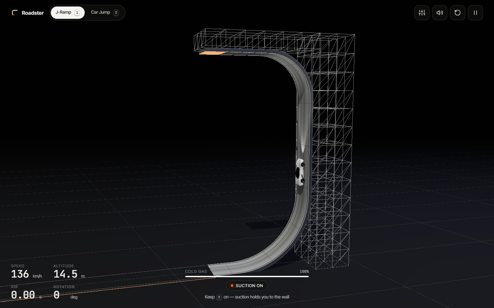
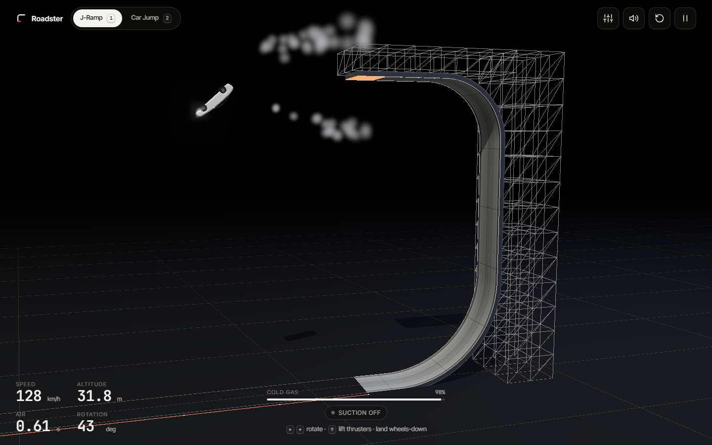
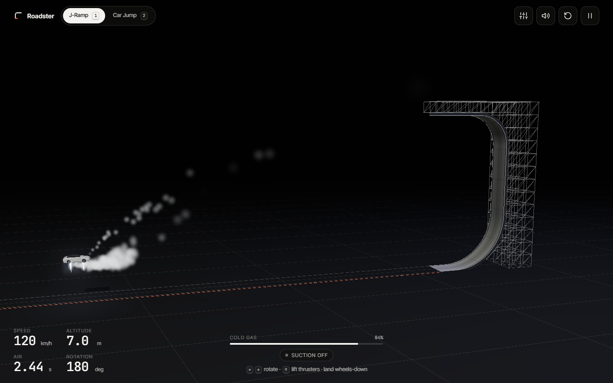
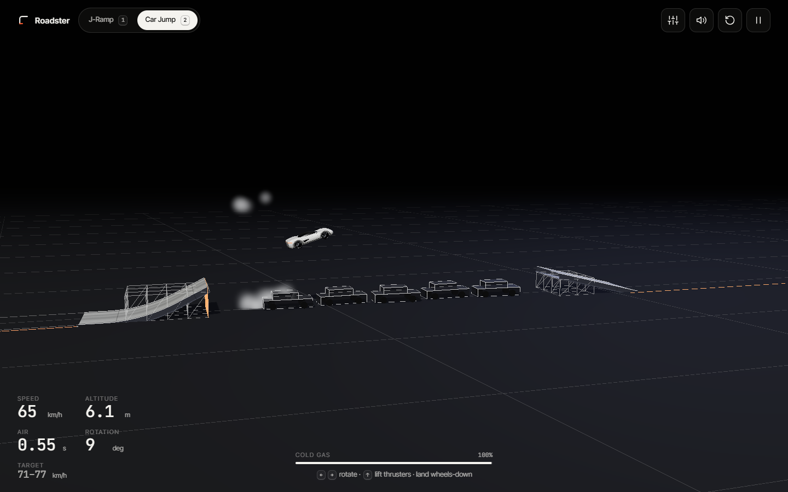
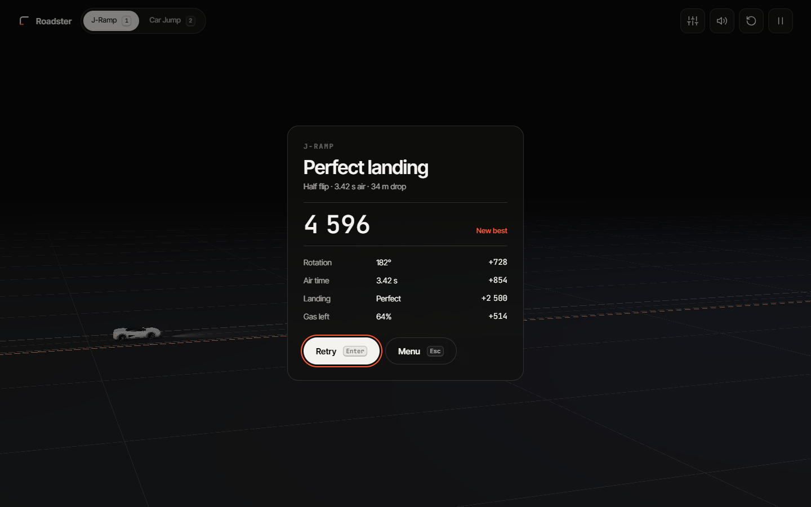
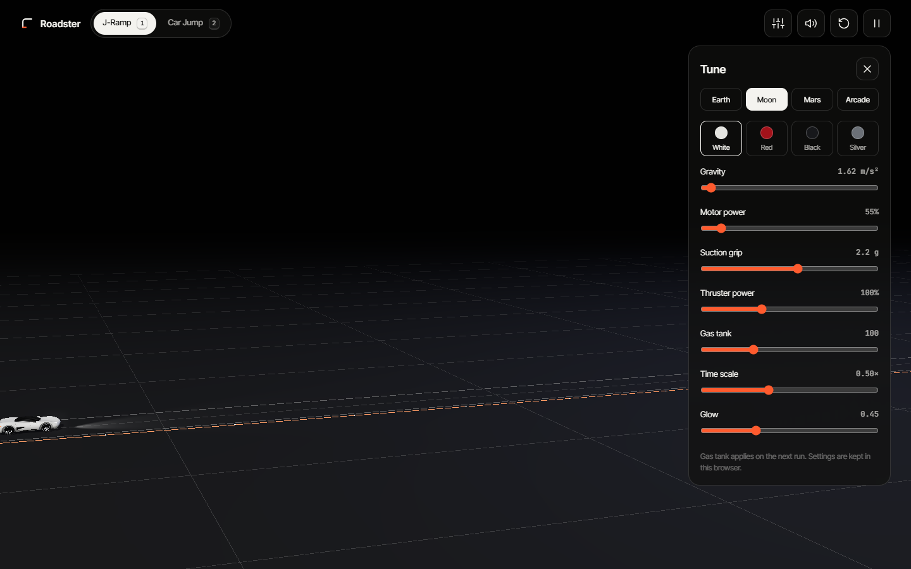
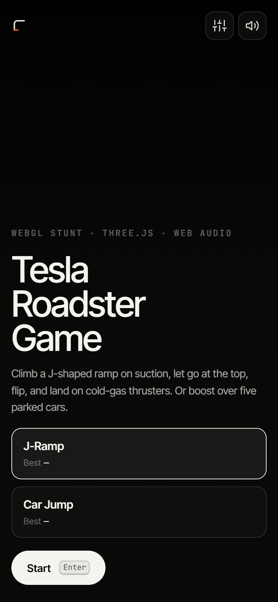

# Roadster — J-Ramp stunt game

A browser stunt game in Three.js. Drive a roadster up a J-shaped ramp on suction, ride the ceiling upside down, **let go**, flip in the air and land on **cold-gas thrusters**. Or hit a kicker at exactly the right speed and **clear five parked cars**.



| Climb on suction | Let go and flip |
| --- | --- |
|  |  |
| **Land on the thrusters** | **Car jump** |
|  |  |

| Result | Tuning panel | Phone |
| --- | --- | --- |
|  |  |  |

## Play

**Live: <https://thefhiter.github.io/roadster-flip/>**

Or run it locally:

```bash
npm start          # → http://localhost:9112
```

No build step and no dependencies: Three.js r170 is vendored in `vendor/three`, so it also runs offline. Any static server works (`python -m http.server` too).

### Controls

| Key | On the ramp | In the air |
| --- | --- | --- |
| <kbd>↑</kbd> / <kbd>W</kbd> | Drive | Lift thrusters (fire through the floor) |
| <kbd>↓</kbd> / <kbd>S</kbd> | Brake, then reverse | — |
| <kbd>Space</kbd> | **Let go**: release suction (on the wall or ceiling) | — |
| <kbd>←</kbd> <kbd>→</kbd> | — | Pitch thrusters: rotate anticlockwise / clockwise |
| <kbd>Shift</kbd> | Rear boost | Rear boost |
| <kbd>R</kbd> · <kbd>Esc</kbd> · <kbd>T</kbd> · <kbd>M</kbd> | Restart · pause · tune · mute | |
| <kbd>1</kbd> / <kbd>2</kbd> | J-Ramp / Car Jump | |

On touch screens, on-screen pads appear (rotate on the left; let go, boost, brake and gas on the right).

### The two challenges

**J-Ramp.** About 110 m of runway into a 12 m quarter-pipe, a 16 m vertical wall, and a hook that leaves you upside down on a 10 m ceiling, 35 m up. Suction keeps you on the ramp. Press <kbd>Space</kbd> on the ceiling, rotate wheels-down (at least half a turn, more for points), then burn the lift thrusters late to soften the touchdown. Score = rotation + air time + landing grade + gas left.

**Car Jump.** A 26° kicker, five parked cars, then a −14° landing ramp. Arriving at **71–77 km/h** lands you on the ramp; the HUD lights up when you're in the window. Leaving the kicker pitches you nose-up, so rotate nose-down to match the landing ramp.

**Landing grades:** *perfect* (within 7° and under 5.5 m/s into the surface), *clean* (within 18°, under 9 m/s), *rough* (within 35°, under 13 m/s). Anything worse, or touching the roof first, is a crash.

## How it works

```
js/physics.js   2D simulation (no rendering deps, unit-tested in Node)
js/car.js       procedural roadster: extruded profile, glass canopy, wheels, 10 cold-gas jets
js/world.js     scenery generated from the same Track objects the physics drives on
js/fx.js        one pooled Points system: thruster smoke, landing dust, crash sparks
js/audio.js     Web Audio synthesis: EV motor whine, gas hiss, wind, one-shot cues
js/main.js      fixed-step loop, input, camera, HUD, tuning, title-screen autopilot demo
```

- **Tracks** are turtle paths (line and arc pieces) sampled into a dense polyline, with exact positions on the arcs. Each sample carries its tangent, its normal and its curvature.
- **On the ramp** the car is a point at arc length *s*. The normal force per unit mass is `N = v²·κ + g·n_y`. The surface can only push (`N ≥ 0`); suction lets it pull too, up to `suction × g` (2.2 g by default). When the required pull exceeds that, the car is "overpowered" and falls off. That's why the ceiling needs suction, and why releasing it drops you.
- **In the air** the car is a rigid body (centre of mass, velocity, angle, spin). The lift thrusters push along the car's own up axis at 2.6 g, so they only slow your fall once you're right side up.
- **Touchdown** checks the four body corners against every surface. A wheel-side corner arriving within the angle, impact and spin limits lands, and the car snaps back onto the ramp keeping its tangential speed. Anything else becomes a crash, simulated with impulse contacts and friction until the wreck stops.
- **Physics runs at a fixed 240 Hz**; rendering interpolates nothing and simply draws the latest state.
- **The title screen** is the game playing itself: a small autopilot controller flies a half flip, then a 1.5 flip, then the car jump at different speeds.

### Tuning panel

<kbd>T</kbd> opens live sliders for gravity, motor power, suction grip, thruster power, gas tank, time scale and glow, plus **Earth / Moon / Mars / Arcade** presets. Settings and best scores stay in `localStorage`.

## Tests

```bash
npm test                                         # 17 physics tests (Node ≥ 20)
NODE_PATH=<dir with playwright> node tools/shoot.cjs [--docs]
```

The unit tests cover track geometry, signed projection, energy conservation, suction hold and loss, landing grades, crashes, fuel, and full autopilot runs of both levels in every gravity preset. The edges of the car-jump speed window are tested too.

`tools/shoot.cjs` plays the real game in Chrome through the actual key handlers: the autopilot's decisions become key presses. It runs 24 checks: title, climb, release, landing, result, car jump, crash, tuning, pause, mobile layout, touch targets and the touch gas button, plus zero console errors. With `--docs` it also refreshes the screenshots above.

## Credits

Inspired by the *Tesla Roadster Game* WebGL component by [Kabarza](https://kabarza.com) on [Flowing](https://flowing.to/components/roadster). Its source isn't public; this is an independent implementation. Fan project, not affiliated with Tesla. The car is a generic procedural model.

Three.js © three.js authors, MIT (`vendor/three/LICENSE`).
